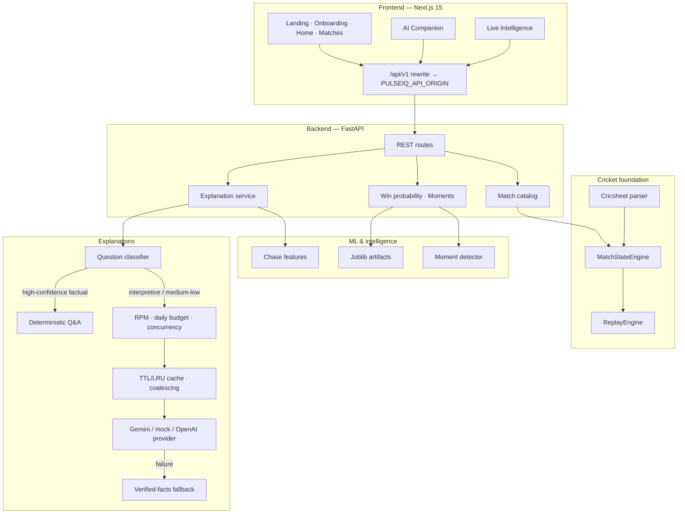

# PulseIQ

**The Adaptive Intelligence Layer for Cricket.**

PulseIQ helps cricket fans cut through match noise, understand what actually matters in a situation, and get explanations matched to their cricket knowledge — from beginner to advanced.

Built for the **Dream11 Forward Deployed Engineer Intern** assignment as a full-stack AI product: historical match intelligence, grounded GenAI explanations, and a polished fan-facing experience.

[](https://github.com/vvinit594/Sports_AI)
[](https://nextjs.org/)
[](https://fastapi.tiangolo.com/)
[](https://ai.google.dev/)

**Live demo:** [pulseiq-frontend.vercel.app](https://pulseiq-frontend.vercel.app/)

*(Frontend proxies API traffic to the configured backend origin. Local API setup is documented below.)*

> This is an assignment showcase project. It is not an official Dream11 product and does not claim Dream11 endorsement.

---

## The problem

Cricket coverage often creates three friction points for fans:

1. **Information overload** — Scorecards, commentary, and stats arrive at once. It is hard to see which deliveries or swings actually changed the game.
2. **Beginner accessibility** — New fans struggle with required rate, powerplays, chase pressure, and tactical language.
3. **One-size-fits-all storytelling** — Most products explain cricket the same way for every viewer, regardless of experience.

That creates space for **adaptive cricket intelligence**: verified match context first, then explanations that meet the fan where they are.

---

## Our solution — PulseIQ

PulseIQ turns reconstructed historical match evidence into clear, level-aware insight:

- **Context-aware intelligence** grounded in ball-by-ball reconstructed state, not invented commentary.
- **Adaptive explanations** for Beginner, Intermediate (API: `casual`), and Advanced audiences.
- **Significant moment detection** when win-probability series are available.
- **Chase win-probability insights** when a trained model artifact is loaded.
- **Natural-language explanations** via Gemini (or mock/OpenAI-compatible providers) with evidence boundaries.
- **Deterministic cricket Q&A** for high-confidence factual questions — zero Gemini spend when the answer is already in the match state.
- **Historical match exploration and replay** over official Cricsheet samples.

The product goal is simple: help fans understand *what happened*, *why it matters*, and *how to read the situation* — without pretending the sample model is production-grade forecasting.

---

## Key features

| Feature | What it does | Problem it solves |
| --- | --- | --- |
| **Personalized insights dashboard** | Home experience after onboarding, tuned by selected experience level | Cuts cold-start confusion; surfaces the right depth of insight |
| **AI Cricket Companion** | Chat over a selected historical match with retry, degraded-mode UX, and level controls | Makes match situations askable in natural language |
| **Audience-aware explanations** | `beginner` / `casual` (UI: Intermediate) / `advanced` prompt and copy styles | Same facts, different clarity and vocabulary |
| **Historical match intelligence** | Catalog, match detail, reconstructed state | Reliable exploration without a live feed |
| **Ball-by-ball reconstruction & replay** | Deterministic state engine + replay tooling | Trustworthy scoreboard and delivery context |
| **Win-probability analysis** | Chase `P(win)` when a Joblib artifact is present | Situation pressure as a number — with honest limits |
| **Significant moments** | Detector over probability swings / pressure events | Highlights turning points instead of every ball equally |
| **Adaptive GenAI explanations** | Structured JSON explanations from verified context | Readable “story” without inventing stats |
| **Deterministic cricket intelligence** | High-confidence factual routing (score, RRR, last ball, …) | Fast, quota-free answers for clear factual questions |
| **Caching, Free-Tier guard & graceful degradation** | TTL/LRU cache, RPM/daily limits, verified-facts fallback when Gemini fails | Stays useful under quota pressure; never fabricates Gemini success |

**Working today:** the table above reflects the current frontend + FastAPI + ML + explanation stack.

**Not claimed as live product:** real-time broadcast feeds, authenticated multi-user cloud history, Redis/shared quota stores, or production-calibrated forecasting.

---

## Product experience

1. Land on PulseIQ and enter the product flow.
2. Complete onboarding — sport focus and **Beginner / Intermediate / Advanced** experience level.
3. Open the **home** insights experience personalized to that level.
4. Browse **matches** and select a historical Cricsheet sample.
5. Explore **Live Intelligence** (historical replay lens) and/or the **AI Companion**.
6. Ask questions or request explanations; answers adapt to audience level.
7. When Gemini is unavailable, Companion can still show **verified reconstructed facts** in a clearly labeled degraded response.

---

## System architecture



No Redis, vector database, agent loop, or live streaming service is part of the current deployment.

---

## Technology stack

| Layer | Technologies |
| --- | --- |
| **Frontend** | Next.js 15 (App Router), React 19, TypeScript, Tailwind CSS 4, Framer Motion, Lucide |
| **Backend** | FastAPI, Uvicorn, Pydantic v2, httpx |
| **Machine learning** | NumPy, pandas, scikit-learn, Joblib |
| **Generative AI** | Google Gemini REST (`generateContent`), optional OpenAI-compatible provider, in-process mock provider |
| **Data** | Official Cricsheet T20 JSON samples (ODC-By license) |
| **Testing** | pytest, Ruff; frontend Node test runner + `tsc` / ESLint |
| **Deployment** | Frontend on Vercel; backend designed for a Python host (e.g. Render-style process) with process-local Gemini guards |

---

## AI and intelligence pipeline

1. **Ingest** Cricsheet JSON into a normalized match model.
2. **Reconstruct** ball-by-ball `MatchState` (scores, overs, targets, rates, terminal flags).
3. **Extract** leakage-safe chase features for eligible second-innings states.
4. **Infer** win probability when a model artifact is loaded; otherwise return explicit unavailability.
5. **Detect** significant moments from the probability series and match events.
6. **Classify** optional user questions (confidence-aware routing).
7. **Answer deterministically** for high-confidence supported factual categories — no Gemini call.
8. **Explain with Gemini** for interpretive / medium / low / omitted-question paths, using compact grounded context.
9. **Protect and degrade gracefully** — process-local RPM/daily/concurrency limits, success caching, and verified-facts fallback when the provider fails.

**Why both deterministic and LLM paths?**

Cricket scoreboard facts should be copied from reconstructed evidence, not re-imagined by a model. Gemini adds narrative and pedagogical value where interpretation helps — while PulseIQ keeps identity fields, grounding rules, and fallback honesty under its own control.

---

## Dataset and model

| Item | Detail |
| --- | --- |
| **Source** | [Cricsheet](https://cricsheet.org/) official samples under `data/raw/cricsheet/samples` |
| **Sample size** | 15 JSON matches in-repo; **11** usable for binary chase-win labels |
| **Reconstruction** | Thousands of delivery/state rows used for engine validation and features |
| **Models** | Heuristic, logistic regression, and constrained random forest baselines (`chase_wp_v1`) |
| **Artifacts** | Joblib files under `backend/models/artifacts` (optional at runtime) |
| **Moments** | Deterministic detector — not a second trained classifier |

**Important:** Eleven labeled matches are enough to verify the pipeline, not to claim production-grade win-probability accuracy. Metrics are held-out diagnostics on a tiny corpus. APIs expose `evaluation_is_meaningful` / limitation fields so the UI and prompts stay honest.

Cricsheet data uses the Open Data Commons Attribution License — see `data/raw/cricsheet/LICENSE.txt`.

---

## API documentation

Base URL (local): `http://127.0.0.1:8000`

Interactive docs: `/docs`, `/redoc`, `/openapi.json`

The Next.js app calls `/api/v1/*`, rewritten to `PULSEIQ_API_ORIGIN`.

<details>
<summary><strong>Primary endpoints</strong></summary>

| Method | Path | Purpose |
| --- | --- | --- |
| `GET` | `/health` | Liveness |
| `GET` | `/api/v1/health/ready` | Readiness + optional Gemini usage snapshot |
| `GET` | `/api/v1/matches` | List historical catalog |
| `GET` | `/api/v1/matches/{match_id}` | Match metadata |
| `GET` | `/api/v1/matches/{match_id}/state` | Reconstructed state (`sequence`, `full`) |
| `GET` | `/api/v1/matches/{match_id}/win-probability` | Chase probabilities when model loaded |
| `GET` | `/api/v1/matches/{match_id}/moments` | Significant moments |
| `POST` | `/api/v1/matches/{match_id}/explanations` | Grounded explanation / deterministic / degraded fallback |

**Explanation request (shape):**

```json
{
  "audience_level": "beginner",
  "sequence": 120,
  "question": "What is the current score?"
}
```

**Explanation sources:** `gemini` · `deterministic` · `fallback` (with `degraded` / `fallback_reason` when AI is unavailable).

Full contracts: [`docs/API.md`](docs/API.md) · GenAI behavior: [`docs/GENAI_EXPLANATIONS.md`](docs/GENAI_EXPLANATIONS.md).

</details>

---

## Project structure

```
Sports_AI/
├── backend/
│   ├── app/
│   │   ├── api/                 # FastAPI routes & errors
│   │   ├── core/                # Settings, rules, logging
│   │   ├── schemas/             # Pydantic models
│   │   └── services/
│   │       ├── ingestion/       # Cricsheet parser
│   │       ├── match_engine/    # State reconstruction
│   │       ├── replay/          # Historical replay
│   │       ├── ml/              # Features, train, inference
│   │       ├── intelligence/    # WP series & moments
│   │       ├── api/             # Catalog wrappers
│   │       └── explanations/    # Routing, Gemini, cache, fallback
│   ├── models/artifacts/        # Joblib baselines
│   ├── scripts/                 # Ingest, train, replay CLIs
│   └── tests/
├── frontend/                    # Next.js product UI
├── data/raw/cricsheet/samples/  # Official historical samples
├── docs/                        # Architecture, API, model card, …
├── .env.example
└── README.md
```

---

## Getting started

### Prerequisites

- Python **3.12+**
- Node.js **20+** (for the frontend)
- Optional: `GEMINI_API_KEY` for hosted explanations (`LLM_PROVIDER=gemini`)

### Clone

```bash
git clone https://github.com/vvinit594/Sports_AI.git
cd Sports_AI
```

### Backend

```powershell
python -m venv .venv
.\.venv\Scripts\Activate.ps1
pip install -r backend\requirements.txt
copy .env.example .env
```

Edit `.env` as needed. **Never commit API keys.** `.env` is gitignored.

Start the API:

```powershell
cd backend
python -m uvicorn app.main:create_app --factory --reload --host 127.0.0.1 --port 8000
```

OpenAPI UI: [http://127.0.0.1:8000/docs](http://127.0.0.1:8000/docs)

### Frontend

```powershell
cd frontend
npm install
npm run dev
```

Open [http://localhost:3000](http://localhost:3000).

In development, `/api/v1` proxies to `http://127.0.0.1:8000` when `PULSEIQ_API_ORIGIN` is unset. Start the API first for Companion, Live Intelligence, and match insights.

Production frontend hosts must set **server-side** `PULSEIQ_API_ORIGIN` (not `NEXT_PUBLIC_*`).

### Configure GenAI

| `LLM_PROVIDER` | Requirement |
| --- | --- |
| `mock` (default) | No key — used by tests and local UI without Gemini |
| `gemini` | `GEMINI_API_KEY` + a current model id (e.g. `gemini-3.8-flash`) |
| `openai` | `OPENAI_API_KEY` (+ optional `OPENAI_BASE_URL`) |

See `.env.example` for Free-Tier guard defaults (`GEMINI_MAX_REQUESTS_PER_MINUTE`, daily budget, cache TTL).

### Optional data / ML CLIs

```powershell
python backend\scripts\ingest_cricsheet.py --input data\raw\cricsheet\samples --output data\processed
python backend\scripts\replay_match.py data\raw\cricsheet\samples\1082591.json
python backend\scripts\audit_dataset.py
python backend\scripts\build_training_dataset.py
python backend\scripts\train_win_probability.py
```

---

## Testing and quality

**Backend** (from `backend/` with the venv active):

```powershell
python -m pytest
ruff check .
ruff format --check .
python -m compileall -q app
```

Automated backend tests use the mock LLM provider / httpx mocks — they do **not** call real Gemini.

*(Currently **260** tests collected in this repository.)*

**Frontend** (from `frontend/`):

```powershell
npm test
npm run typecheck
npm run lint
npm run build
```

---

## Current limitations

- **Historical samples only** — not a live match feed or broadcast integration.
- **Small labeled corpus (11 matches)** — win-probability quality is pipeline-level, not production calibration.
- **Gemini dependence** — interpretive explanations need provider availability and respect process-local Free-Tier style budgets.
- **Process-local guards & cache** — RPM/daily counters and explanation cache are not shared across multiple workers/hosts.
- **No end-user auth / cloud chat storage** — Companion history is local to the browser.
- **No Redis / Postgres** in the current architecture.

---

## Future roadmap

Planned directions (not implemented):

- Real-time or near-real-time cricket data providers behind the existing catalog seam.
- Stronger models and larger Cricsheet corpora with meaningful evaluation.
- Richer personalization and multi-turn Companion memory (with clear privacy boundaries).
- Shared quota/cache infrastructure if multi-instance hosting is required.
- Lower-latency explanation paths and broader deterministic cricket coverage.

---

## Assignment overview

PulseIQ was built for the **Dream11 Forward Deployed Engineer Intern** assignment. The focus was product-minded engineering: take a real fan problem (match complexity and uneven cricket literacy), ship a credible AI experience on verified cricket evidence, and be explicit about what the model can and cannot claim.

Core engineering bets:

- Reconstruct first, generate second.
- Prefer deterministic answers when the fact is already in state.
- Keep GenAI grounded, guarded, and degradable.
- Present limitations as product honesty, not fine print.

---

## Documentation map

| Doc | Contents |
| --- | --- |
| [`docs/ARCHITECTURE.md`](docs/ARCHITECTURE.md) | System design through Phase 5 |
| [`docs/API.md`](docs/API.md) | HTTP contracts and errors |
| [`docs/GENAI_EXPLANATIONS.md`](docs/GENAI_EXPLANATIONS.md) | Routing, cache, fallback semantics |
| [`docs/MODEL_CARD.md`](docs/MODEL_CARD.md) | Baseline models and evaluation stance |
| [`docs/DATASET.md`](docs/DATASET.md) | Sample composition and labels |
| [`docs/FEATURES.md`](docs/FEATURES.md) | Feature schema notes |
| [`frontend/README.md`](frontend/README.md) | Frontend-specific run notes |

---

## Screenshots

Product screenshots are not checked into this repository yet.

> **Optional:** Add images under `docs/images/` (landing, onboarding, Companion, Live Intelligence) and link them in **Product experience** / **Key features** for an even stronger first impression.

---

## License notes

Application code: see repository license terms if present.

Cricsheet sample data: Open Data Commons Attribution License (`data/raw/cricsheet/LICENSE.txt`).
